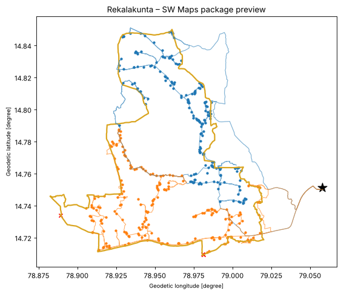

# Rekalakunta Micro-Landscape: KML layers

Field-visit layers for **Rekalakunta Micro Landscape** (Brahmamgarimattam mandal, YSR Kadapa district),
converted to **KML** in WGS 84 (lat/long). They open in Google Earth, Google My Maps, QGIS, and most
mobile GIS and navigation apps.



## Files

`Rekalakunta_KML.zip` contains all of the files below. They are also in the `kml/` folder.

| File | Contents |
|---|---|
| `Rekalakunta_all_layers.kml` | **Every layer in one file**, one folder per layer |
| `Rekalakunta_boundary.kml` | Landscape boundary polygon (10,968.97 ha), yellow outline |
| `Rekalakunta_accommodation.kml` | Accommodation point (start and end of each day), lodging icon |
| `Rekalakunta_day1_route.kml` | Day 1 route, 125.0 km, blue line |
| `Rekalakunta_day1_plots.kml` | 194 Day 1 plots, blue, labelled with the plot ID |
| `Rekalakunta_day2_route.kml` | Day 2 route, 110.2 km, orange line |
| `Rekalakunta_day2_plots.kml` | 206 Day 2 plots, orange; the 3 unrouted plots are red |

Each plot is labelled with its ID (e.g. `P176`). The popup reads, for example,
`Day 1 · stop 1 · ETA 09:15`.

Each plot also carries these attribute fields (KML ExtendedData):

| Field | Meaning |
|---|---|
| `plot_id` | Plot ID |
| `day` | Field day |
| `stop_no` | Stop number on the route |
| `eta` | Planned arrival time |
| `eta_plus_d` | Days after the start day |
| `routed` | Whether the plot is on the route |
| `in_bound` | Whether the plot is inside the landscape boundary |
| `lat`, `lon` | Coordinates |

## Issues in the source plan

1. **Each "day" route lasts about 30 hours.** Day 1 starts at 09:15 and its last stop has an ETA of
   15:57 the next day. Day 2 starts at 09:13 and finishes at 14:45 the next day. Stops with an ETA
   before 18:00 on the start day:
   - Day 1: **51 of 194**
   - Day 2: **65 of 203** routed stops

   At that pace, all 400 plots need about **6–8 field days**, not 2.
2. **3 Day 2 plots have no route:** `P232`, `P235`, `P274` (shown in red).
3. **16 plots lie outside the landscape boundary** (`in_bound = No`):
   - Day 1: P314, P308, P110
   - Day 2: P387, P390, P389, P029, P033, P030, P032, P273, P272, P229, P393, P394, P395

## Rebuilding

The original uploads are in `source/`. To regenerate every KML:

```bash
pip install pyogrio geopandas
python build_kml.py
```
