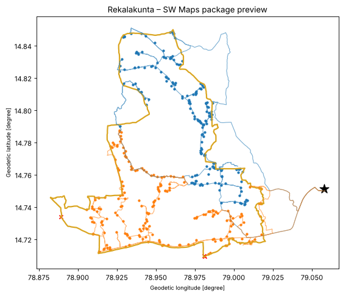

# Rekalakunta Micro-Landscape: SW Maps field package

Field-visit layers for **Rekalakunta Micro Landscape** (Brahmamgarimattam mandal, YSR Kadapa district),
converted so they load in **SW Maps** on Android. Everything is in **WGS 84 (EPSG:4326)**, 2D, with
clean attribute names.



## What to copy to the phone

`Rekalakunta_SWMaps_package.zip` holds everything below. Copy it to the phone and unzip it,
for example into `Download/`.

| File | Use in SW Maps |
|---|---|
| `Rekalakunta_SWMaps.kmz` | **Start with this one.** All layers in one file, already styled and labelled with plot IDs. |
| `Rekalakunta_SWMaps.gpkg` | The same 6 layers as a GeoPackage, with full attribute tables. |
| `Rekalakunta_shapefiles_WGS84.zip` | The same 6 layers as separate shapefiles, if you'd rather add them one by one. |
| `Rekalakunta_plots_routes.gpx` | Waypoints and the two routes, for navigation apps such as OsmAnd or Organic Maps. |
| `Rekalakunta_plot_list.csv` | Plot checklist (ID, day, stop, ETA, lat/lon) to print or open in Excel. |

### Layers

| Layer | Type | Features | Style in the KMZ |
|---|---|---|---|
| `boundary` | Polygon | 1 (10,968.97 ha) | Yellow outline |
| `plots_day1` | Point | 194 | Blue |
| `plots_day2` | Point | 206 | Orange, with the 3 unrouted plots in red |
| `route_day1` | Line | 1 (125.0 km) | Blue |
| `route_day2` | Line | 1 (110.2 km) | Orange |
| `accommodation` | Point | 1 | Lodging icon |

Plot attributes: `plot_id`, `day`, `stop_no`, `eta`, `eta_plus_d` (days after the start day),
`routed`, `in_bound` (inside the landscape boundary), `lat`, `lon`, `status` (set to `Pending`), `remarks`.

## Loading it in SW Maps

1. Open **SW Maps**, then **New Project** and name it `Rekalakunta`.
2. Open the side menu, go to **Map Layers** and tap **+ / Add Layer**.
3. Pick `Rekalakunta_SWMaps.kmz`. You can add the `.gpkg` or the shapefiles the same way.
4. Set the base map (for example Google Satellite) and **download offline tiles** for the area
   while you still have network. The area is roughly 78.87–79.06 E, 14.70–14.86 N.
5. Tap any plot to see its ID, stop number and ETA. Use **Navigate / Stakeout** to walk to it.

> Layers added this way are reference overlays you can view but not edit. Record field
> observations in a separate feature layer (next section).

### Suggested data-collection layer

Create this in SW Maps under **Feature Layers → +**:

**Layer:** `Plot_Visit` (Point)

| Attribute | Type | Values |
|---|---|---|
| `plot_id` | Text | e.g. `P176` |
| `visit_status` | Options | Visited / Not accessible / Not found / Skipped |
| `photo_n`, `photo_e`, `photo_s`, `photo_w` | Photo | |
| `remarks` | Text | |

At each plot, use **averaging** when you record the point so the location is more accurate.
Afterwards, export with **Share/Export → GeoPackage or Shapefile**.

## Issues in the source plan

Fix these in the routing plan before going to the field:

1. **Each "day" route lasts about 30 hours.** Day 1 starts at 09:15 and its last stop has an ETA of
   15:57 the next day. Day 2 starts at 09:13 and finishes at 14:45 the next day. Stops with an ETA
   before 18:00 on the start day:
   - Day 1: **51 of 194**
   - Day 2: **65 of 203** routed stops

   At that pace, all 400 plots need about **6–8 field days**, not 2. Re-split the routes before the
   visit. The `eta_plus_d` field marks the stops that spill into the next day.
2. **3 Day 2 plots have no route:** `P232`, `P235`, `P274` (`routed = No`, shown in red).
3. **16 plots lie outside the landscape boundary** (`in_bound = No`):
   - Day 1: P314, P308, P110
   - Day 2: P387, P390, P389, P029, P033, P030, P032, P273, P272, P229, P393, P394, P395
4. The boundary's `Area` field is in hectares: 10,968.97 ha, which is 109.7 km².

## Rebuilding

The original uploads are in `source/`. To regenerate every output:

```bash
pip install pyogrio geopandas
python build_swmaps.py
```
